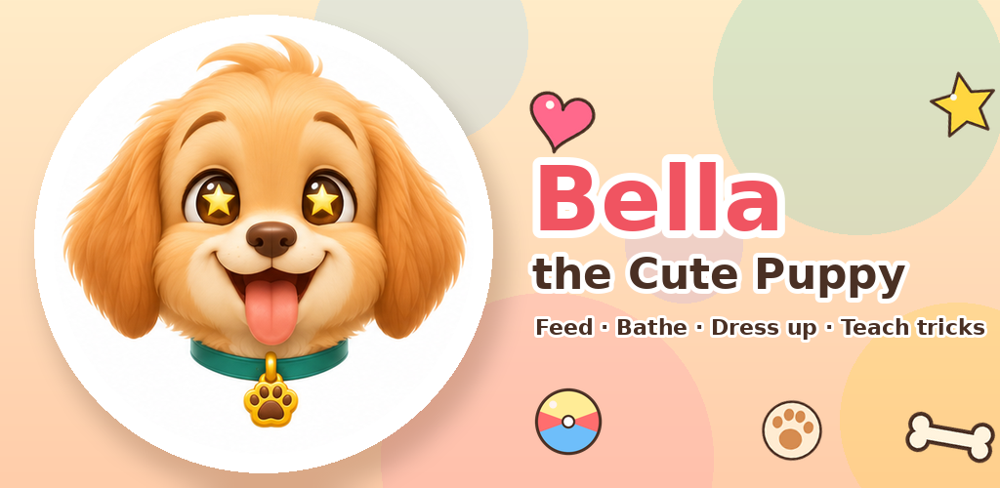
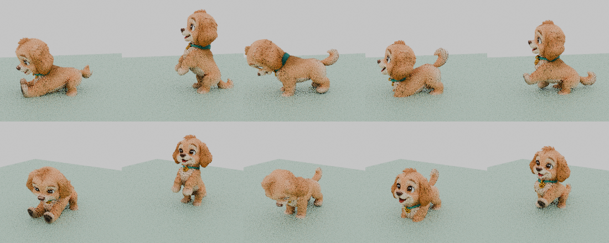
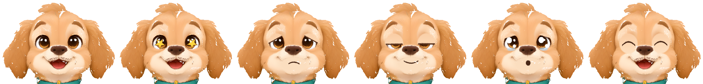

# Bella — The Cute Puppy

A 3D virtual-pet game for **Android / Google Play** starring Bella, a small, very happy Golden
Retriever puppy. Gentle, ad-free, purchase-free, offline. Original character, art, sound and code;
all art made with AI tools and scripts — zero human spend.



## Where things stand (12 Nov 2026)

**All game work that can be done without Unity is finished.** The complete v1 game is in this
repository: code, Bella's rigged and animated model, faces, sounds, music, icons, store text,
privacy policy and tester kit. It has been compile-checked outside Unity but **has not yet been run
inside Unity** — that first run is the next step.

| You want to… | Read |
|---|---|
| Do the PC session (install Unity, press Play, build for phone) | **[docs/UNITY_DAY.md](docs/UNITY_DAY.md)** |
| Start the next Claude chat | **[docs/NEXT_CHAT.md](docs/NEXT_CHAT.md)** |
| See the whole plan and what is ticked off | [docs/PLAN.md](docs/PLAN.md) |
| Fill in Google Play | [docs/store/](docs/store/) — listing text, every console form, closed-test kit |

## What she looks like

Rendered in Blender from the exact model, textures and animations the game uses (not in-game screenshots):




Home-screen layout drawn from the real HUD coordinates and icons: [docs/preview/home_screen_layout_mockup.png](docs/preview/home_screen_layout_mockup.png)

## What is in the game

- **Bella** — rigged 3D puppy with 15 animations, six face expressions, blinking, a tail that wags
  with her mood, floppy-ear physics and a head that follows your finger
- **Her room** — bowl, bed, ball, rug and window; lighting follows the real time of day
- **Care** — feed, bubble bath, sleep, fetch, stroking; five needs that drift down in real time,
  including while the app is closed (with a kindness cap — she is never miserable)
- **Thought bubbles** — one picture shows what she wants; tap it to do it. No reading needed
- **Mini-games** — Trick Training (draw a shape, she does the trick), Wardrobe (12 outfits),
  The Clinic (pick the right tool), Bubble Bath (sponge, shower, towel)
- **Long loop** — treats, a present every day, days-together counter, 18 stickers, Bella grows
  over real weeks, an occasional gentle "sniffles" visit to the clinic
- **For parents** — arithmetic gate, sound/music switches, privacy summary, start over
- **Compliance by construction** — no network code, no SDKs, no permissions, local save only

## Repository layout

```
unity-project/            the Unity project — open THIS folder in Unity Hub (Unity 6.3 LTS)
  Assets/Scripts/         45 C# scripts; Core/GameRoot.cs builds the whole game at Play time
  Assets/Resources/       Bella's model + faces, icons, portraits, audio
docs/                     plan, design, architecture, art bible, Unity-day guide, handoff
docs/store/               store listing, Play Console answers, closed-test kit, graphics
docs/privacy.html         privacy policy page (served by GitHub Pages)
art-source/               raw AI mesh, concept faces, the rigged + animated .blend
tools/pipeline/           scripts that produced the model, animations, faces, icons and audio
tools/stubcheck/          compile-check for all scripts without Unity (needs only dotnet)
tools/gesture-test/       accuracy test for the trick-drawing recogniser
docs/preview/             Blender renders of Bella and a home-screen layout mock-up
CREDITS.md                where every asset came from
```

## How it is built (for whoever continues the code)

There is no hand-wired scene and no Inspector setup. `GameRoot` creates camera, light, room, Bella,
audio, HUD and every system in code when Play starts, in any scene. An editor script
(`Assets/Scripts/Editor/BellaProjectSetup.cs`) runs by itself the first time the project opens and
creates the scene, three materials and the Android settings; a second one applies import settings.
Details: [docs/ARCHITECTURE.md](docs/ARCHITECTURE.md).
